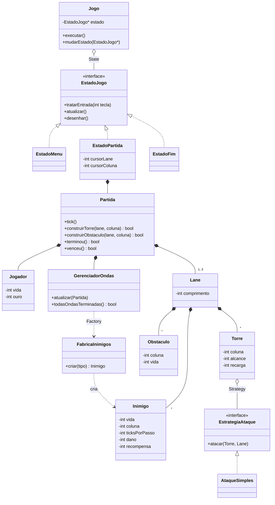
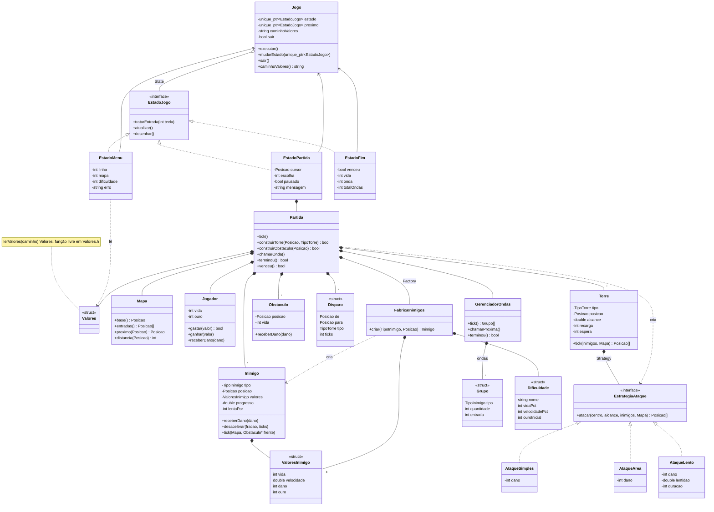

# Relatório do desenvolvimento do projeto Lane Based Combat Game

## 1. Requisitos

### 1.1 Glossário

| Termo | Significado |
|---|---|
| **Mapa** | Grade de casas de 56x21. Cada casa é chão (`.`), caminho (`#`) ou Jogador (`@`). |
| **Caminho** | Sequência de casas `#` que vai de uma entrada até o Jogador. Os caminhos são as "lanes" do enunciado. Dois caminhos podem se juntar antes do Jogador. |
| **Entrada** | Casa de caminho na borda do mapa. Os inimigos nascem nela. |
| **Jogador** | A base fixa (`@`) no fim de todos os caminhos. Tem HP e ouro. Representa o "personagem do jogador" do enunciado. |
| **Inimigo** | Unidade que nasce em uma entrada e anda pelo caminho até o Jogador. |
| **Torre** | Estrutura colocada pelo jogador em uma casa de chão. Ataca os inimigos dentro do alcance. |
| **Obstáculo** | Barreira com HP colocada pelo jogador em uma casa de caminho. Faz o inimigo parar e atacá-la até ela quebrar. |
| **Onda** | Grupo de inimigos que entra em sequência. |
| **Tick** | Passo fixo de tempo do jogo (10 por segundo). |

### 1.2 Requisitos funcionais

| ID | Requisito |
|---|---|
| RF01 | O menu permite escolher o mapa: 1, 2 ou 3 entradas. |
| RF02 | O jogo desenha no terminal o mapa em grade: o chão, o caminho, o Jogador, os inimigos, as torres e os obstáculos. |
| RF03 | Os inimigos nascem nas entradas, em ondas, com intervalo entre uma onda e outra. Uma tecla começa a próxima onda antes do fim do intervalo. |
| RF04 | Cada inimigo anda pelo caminho em direção ao Jogador, com a velocidade do seu tipo (casas por segundo). |
| RF05 | Quando um inimigo chega ao Jogador, ele tira HP do Jogador e é removido. |
| RF06 | O Jogador começa com HP e ouro definidos. O jogo termina em derrota quando o HP chega a 0. |
| RF07 | O jogador move um cursor pelas casas do mapa usando as setas do teclado. |
| RF08 | O jogador escolhe um tipo de torre e a constrói na casa do cursor, se a casa for chão livre e houver ouro suficiente. |
| RF09 | A torre ataca o inimigo dentro do alcance (um círculo) que está mais perto do Jogador pelo caminho, respeitando um tempo de recarga. |
| RF10 | O jogador constrói um obstáculo na casa do cursor, se a casa for caminho livre (fora das entradas) e houver ouro suficiente. |
| RF11 | Um inimigo que encontra um obstáculo para e causa dano a ele até destruí-lo. Depois volta a andar. |
| RF12 | Cada inimigo morto dá ouro ao Jogador. Cada onda completa dá um bônus de ouro. |
| RF13 | O jogo termina em vitória quando o jogador sobrevive a todas as ondas do mapa. |
| RF14 | Um painel ao lado do mapa mostra HP, ouro, a onda atual, as construções com seus custos, a casa sob o cursor e as teclas. |
| RF15 | A tela final mostra vitória ou derrota e permite voltar ao menu ou sair. |
| RF16 | Cada ataque desenha por um instante um rastro (`/`, `\`, `-` ou `|`) da torre até o alvo. |
| RF17 | Com o cursor sobre uma torre, o mapa destaca as casas no alcance dela. Com o cursor sobre uma casa onde a torre escolhida pode ser construída, o mapa mostra o alcance que ela teria. |

### 1.3 Funcionalidades extras

| ID | Extra |
|---|---|
| FE01 | Novos tipos de inimigo: **Rápido** (pouco HP, anda depressa) e **Tanque** (muito HP, anda devagar). |
| FE02 | Seleção de dificuldade no menu: Fácil, Normal e Difícil mudam o HP e a velocidade dos inimigos e o ouro inicial. |
| FE03 | Tipos de torre: **Simples** (dano em um alvo), **Área** (dano em todos os inimigos no alcance), **Lenta** (reduz a velocidade do alvo) e **Longa** (alcance longo, recarga lenta, muito dano). |

### 1.4 Requisitos não funcionais

| ID | Requisito |
|---|---|
| RNF01 | O jogo é feito em C++17 com interface de terminal (ncurses) |
| RNF02 | O jogo compila com CMake no Linux, sem warnings com `-Wall -Wextra`. |
| RNF03 | O jogo funciona em um terminal de no mínimo 80x24. |
| RNF04 | O jogo usa tick fixo, então a velocidade não depende da máquina. |
| RNF05 | O design aplica os patterns Factory, Strategy e State (detalhes na modelagem). |
| RNF06 | A lógica (movimento, dano, ataques, ondas e leitura dos valores) tem testes com `assert`, separados da interface. |
| RNF07 | Todos os números do jogo ficam no arquivo `valores.txt`. O jogo lê o arquivo no começo de cada partida, então é possível ajustar o equilíbrio sem compilar de novo. |

### 1.5 Decisões e suposições

- **As "lanes" do enunciado são os caminhos do mapa.** O mapa 1 tem um caminho. Os mapas 2 e 3 têm duas e três entradas, e os caminhos se juntam antes do Jogador.
- **O Jogador é uma base fixa.** O enunciado fala em "personagem do jogador". Nós o interpretamos como a base com HP que os inimigos tentam alcançar. O jogador age construindo torres e obstáculos.
- **Torres ficam no chão e obstáculos no caminho.** Cada casa tem no máximo uma estrutura. A torre não bloqueia inimigos. Só o obstáculo bloqueia, então cada um tem um papel claro: a torre causa dano e o obstáculo segura o avanço.
- **Uma torre ataca qualquer caminho dentro do alcance.** Uma torre perto do ponto onde dois caminhos se juntam defende os dois.
- **A torre ataca o inimigo mais perto do Jogador.** O RF09 diz "inimigo mais próximo". Lemos como o mais perto do Jogador, medido em casas pelo caminho, porque ele é o mais perigoso. Essa é a regra comum em jogos de tower defense.
- **O alcance é um círculo na grade** (dx² + dy² ≤ alcance²). Como as casas do terminal são mais altas que largas, o círculo aparece como um oval na tela. Preferimos a mesma distância em linhas e colunas, que é mais simples de entender nas regras.
- **Vários inimigos podem ficar na mesma casa.** Os inimigos não bloqueiam uns aos outros. Atrás de um obstáculo eles se acumulam, e a torre de Área fica forte contra esse grupo.

## 2. Modelagem inicial

Esta modelagem não inclui as funcionalidades extras. Ela é a primeira versão do jogo, com lanes retas. Depois o jogo passou a usar um mapa em grade (seção 3.2). A modelagem final, com a grade e os extras, está na seção 5.

### 2.1 Diagrama de classes



### 2.2 Responsabilidades

| Classe | Responsabilidade |
|---|---|
| **Jogo** | Executa o laço principal. Guarda o estado atual e faz a troca de estado. |
| **EstadoJogo** | Interface de uma tela: lê as teclas, atualiza e desenha. |
| **EstadoMenu** | Mostra a escolha do mapa (1, 2 ou 3 lanes). |
| **EstadoPartida** | Liga a Partida ao terminal: move o cursor, chama `tick()` e desenha o mapa e o HUD. |
| **EstadoFim** | Mostra vitória ou derrota. Volta ao menu ou sai. |
| **Partida** | Contém toda a lógica do jogo. Não usa ncurses. |
| **Jogador** | Guarda o HP e o ouro. |
| **Lane** | Representa uma linha de casas. Guarda os inimigos, as torres e os obstáculos dela. |
| **Inimigo** | Anda uma casa a cada `ticksPorPasso` ticks. Para diante de um obstáculo e o ataca. |
| **Torre** | Ataca na própria lane quando a recarga termina, por meio da sua EstrategiaAtaque. |
| **Obstaculo** | Bloqueia a casa até o HP chegar a 0. |
| **EstrategiaAtaque** | Define como a torre escolhe os alvos e causa dano. |
| **AtaqueSimples** | Causa dano no inimigo mais próximo dentro do alcance. |
| **GerenciadorOndas** | Controla quando cada onda e cada inimigo entram no mapa. |
| **FabricaInimigos** | Cria um inimigo a partir do tipo. |

### 2.3 Design patterns

**State (Jogo e EstadoJogo).** Cada tela responde de forma diferente às mesmas teclas. Por exemplo, as setas mudam a opção no menu e movem o cursor na partida. Cada tela é uma classe, e o Jogo só repassa as chamadas para o estado atual. Sem o pattern, o laço principal precisaria de um `switch` sobre a tela atual em cada etapa.

**Strategy (Torre e EstrategiaAtaque).** A torre controla a recarga. A estratégia escolhe os alvos dentro do alcance e aplica o efeito. A modelagem inicial tem só o AtaqueSimples. A funcionalidade extra FE03 acrescenta novos ataques sem alterar a classe Torre.

**Factory (FabricaInimigos).** As ondas são descritas como dados: o tipo do inimigo, a lane e o momento de entrada. O GerenciadorOndas passa o tipo para a fábrica e recebe o inimigo pronto. Os valores de cada tipo (HP, velocidade, dano e recompensa) ficam em um só lugar. Os extras FE01 (novos inimigos) e FE02 (dificuldade) só alteram a fábrica.

### 2.4 Decisões de modelagem

- **A Partida não usa ncurses.** Só as classes EstadoJogo leem o teclado e desenham. Assim os testes (RNF06) criam uma Partida, chamam `tick()` e verificam o resultado sem abrir o terminal.
- **A Lane guarda os seus inimigos, torres e obstáculos.** A torre só ataca a própria lane, então já recebe a lista certa de inimigos.
- **O State fica só nas telas.** O inimigo tem apenas dois comportamentos: andar ou atacar o obstáculo à frente. Uma condição simples resolve isso. Estados para o inimigo acrescentariam classes sem ganho.
- **O jogo não tem aleatoriedade.** As ondas de cada mapa são fixas, então as mesmas ações dão sempre o mesmo resultado. Isso deixa os testes previsíveis.
- **Os nomes no código são em português**, iguais aos da modelagem.

## 3. Implementação

### 3.1 Como compilar, testar e jogar

```sh
cmake -S . -B build
cmake --build build
ctest --test-dir build --output-on-failure   # testes da lógica
./build/td                                   # o jogo (terminal de 80x24 ou mais)
./build/td outro.txt                         # o jogo com outro arquivo de valores
```

| Tecla | Ação |
|---|---|
| Setas | No menu: escolher o mapa e a dificuldade. Na partida: mover o cursor (com Shift, 5 casas). |
| `1` a `5` | Escolher o que construir: torre Simples, Área, Lenta, Longa ou obstáculo. |
| Espaço ou Enter | Construir na casa do cursor. No menu: começar. Na tela final: voltar ao menu. |
| `n` | Começar a próxima onda agora. |
| `p` | Pausar ou continuar. |
| `q` | Na partida: voltar ao menu. No menu e na tela final: sair. |

| Símbolo | Significado |
|---|---|
| `.` `#` `@` | Chão, caminho e o Jogador. |
| `o` `r` `O` | Inimigos Normal, Rápido e Tanque. Um inimigo lento aparece em ciano. Um inimigo atingido pisca. |
| `S` `A` `L` `X` | Torres Simples, Área, Lenta e Longa. |
| `=` | Obstáculo. O `#` já é o caminho, então o obstáculo usa outro símbolo. |
| `/` `\` `-` `|` | Rastro de um ataque. |
| casas em azul | Alcance da torre sob o cursor, ou da torre escolhida. |

### 3.2 Do modelo de lanes para o mapa em grade

A primeira versão do jogo usava lanes retas: uma linha de casas por lane, com os inimigos andando da direita para a esquerda. Depois de jogar essa versão, o aluno decidiu mudar para um mapa em grade, na linha de *Cataclysm: DDA* (o mapa desenhado com caracteres) e de *Bloons TD* (caminhos fixos que fazem curvas). Com a grade, onde colocar cada torre virou uma decisão real: perto de uma curva, a torre alcança mais casas de caminho. Perto do ponto onde dois caminhos se juntam, ela defende os dois.

O que mudou no código:

- A classe `Lane` saiu. A classe `Mapa` guarda a grade e calcula, com uma busca em largura a partir do Jogador, a próxima casa e a distância até o Jogador para cada casa de caminho. Os caminhos não podem encostar um no outro, senão a busca acharia um atalho entre eles. Um teste confere que, nos três mapas, todas as entradas chegam ao Jogador.
- A posição de um inimigo é uma casa `(x, y)`, e a velocidade é em casas por segundo. Cada tick soma uma fração de casa. Quando a soma passa de 1, o inimigo vai para a próxima casa.
- A Partida guarda os inimigos, as torres e os obstáculos, que antes ficavam em cada Lane.
- As estratégias de ataque devolvem as posições atingidas. A Partida guarda essas posições por 2 ticks como `Disparo`, e a tela desenha o rastro.

### 3.3 Decisões tomadas durante a implementação

- **Ordem de um tick.** Os inimigos da onda entram, as torres atacam, os inimigos vivos andam ou atacam, os obstáculos quebrados saem, e por fim os inimigos mortos dão ouro e os que chegaram ao Jogador tiram HP. Um inimigo morto pela torre não anda no mesmo tick.
- **O inimigo ataca o obstáculo uma vez por segundo** (`obstaculo.intervaloAtaque`). Cada golpe causa o `dano` do inimigo, o mesmo valor que ele tira do Jogador quando chega.
- **Construção.** Torres só vão em chão livre. Obstáculos só vão em caminho livre, fora das entradas. A construção pode acontecer em uma casa com inimigos. O obstáculo só bloqueia os inimigos que ainda não passaram por ele.
- **A recarga só começa depois de um ataque.** Uma torre sem alvo fica pronta e ataca no primeiro tick em que um inimigo entra no alcance.
- **Lentidão.** Um acerto da torre Lenta tira 50% da velocidade do alvo por 2 s. Um novo acerto reinicia o tempo. Os efeitos não se acumulam.
- **Ondas.** Os grupos que entram pela mesma entrada vêm um depois do outro. Entradas diferentes criam inimigos ao mesmo tempo. Quando o último inimigo de uma onda entra, o jogador recebe o bônus, e a espera até a próxima onda começa. A espera não depende de os inimigos morrerem. A tecla `n` termina a espera.
- **Vitória e derrota.** A derrota acontece quando o HP chega a 0. A vitória acontece quando todas as ondas já entraram e não há mais inimigos no mapa.
- **Não é possível vender estruturas.** O enunciado não pede isso. As decisões de onde construir ficam mais importantes.
- **Velocidade máxima de 10 casas por segundo.** Um inimigo anda no máximo uma casa por tick, porque o obstáculo da frente só é verificado para a próxima casa. Os valores atuais ficam abaixo desse limite.

### 3.4 Valores e balanceamento

O aluno participou do balanceamento em três passos:

1. **Metas.** O aluno escolheu partidas curtas (8 ondas, cerca de 4 minutos), ouro por inimigo morto mais um bônus por onda (como no Bloons TD), e um Normal que um jogador cuidadoso vence na primeira tentativa.
2. **Tabela inicial.** A IA propôs uma tabela de valores a partir dessas metas e o aluno a aprovou (tabelas abaixo).
3. **Simulação e ajuste.** Simulamos partidas com um jogador automático simples. Ele coloca cada torre na casa de chão que cobre mais casas de caminho, sem usar obstáculos. Sem defesa, o jogador perde em todos os mapas. Com o jogador automático, o mapa 1 no Normal foi uma vitória sem perder HP, em cerca de 3 minutos. Nos mapas 2 e 3, o jogador automático perdia na onda 4, porque mais entradas pedem mais torres logo no começo. O aluno escolheu dar ouro extra por mapa (`mapaN.ouro`: 0, 100 e 100) em vez de aumentar o ouro de todos os mapas, o que deixaria o mapa 1 ainda mais fácil. Com essa mudança, o jogador automático vence os três mapas no Normal (com 20, 5 e 11 de HP). No Difícil, ele perde nas ondas 3 e 4. O aluno decidiu manter o Difícil assim e julgar depois de jogar, porque um jogador humano usa obstáculos e os pontos de junção dos caminhos.

Todos os números ficam em `valores.txt`, com comentários. Uma chave desconhecida, repetida ou faltando é erro, com o número da linha, e o menu mostra a mensagem. Assim um erro de digitação não passa despercebido.

O jogo tem 10 ticks por segundo. O Jogador começa com 20 de HP. Cada onda completa dá 25 de ouro. A primeira onda começa depois de 10 s, a espera entre ondas é de 8 s e o intervalo entre dois inimigos da mesma entrada é de 0,8 s.

| Inimigo | HP | Velocidade (casas/s) | Dano | Ouro |
|---|---|---|---|---|
| Normal (`o`) | 10 | 3,5 | 1 | 3 |
| Rápido (`r`) | 6 | 6,0 | 1 | 4 |
| Tanque (`O`) | 50 | 2,0 | 5 | 12 |

| Estrutura | Custo | Alcance | Recarga (s) | Efeito |
|---|---|---|---|---|
| Simples (`S`) | 60 | 4 | 0,5 | 2 de dano no alvo |
| Área (`A`) | 100 | 3 | 1,2 | 2 de dano em todos no alcance |
| Lenta (`L`) | 50 | 4 | 1,0 | 1 de dano e 50% de lentidão por 2 s |
| Longa (`X`) | 90 | 10 | 2,5 | 15 de dano no alvo |
| Obstáculo (`=`) | 25 | - | - | 20 de HP |

| Dificuldade | HP dos inimigos | Velocidade dos inimigos | Ouro inicial |
|---|---|---|---|
| Fácil | 75% | 85% | 250 |
| Normal | 100% | 100% | 200 |
| Difícil | 130% | 115% | 150 |

O ouro extra por mapa é somado ao ouro inicial. Cada mapa tem 8 ondas fixas. Os mapas 2 e 3 têm cerca de 1,3 e 1,6 vezes os inimigos do mapa 1, divididos entre as entradas.

### 3.5 Testes

`tests/testes.cpp` tem 36 testes com `assert`, um comportamento por teste. Os testes cobrem o Jogador, o Mapa (entradas, caminho até o Jogador, alcance em círculo), o movimento, o ataque ao obstáculo e a lentidão do Inimigo, as estratégias de ataque, a recarga da Torre, o GerenciadorOndas, a leitura de `valores.txt` (incluindo chaves erradas), a FabricaInimigos e a Partida (construção, ouro, bônus, vitória e derrota). A interface ncurses não tem testes automáticos. Nós a testamos jogando.

## 4. Funcionalidades extras

- **FE01: novos tipos de inimigo.** O **Rápido** tem pouco HP e anda quase duas vezes mais depressa que o Normal. O **Tanque** tem cinco vezes mais HP, anda devagar e tira 5 de HP do Jogador. Só a FabricaInimigos cria inimigos, a partir dos valores do arquivo.
- **FE02: seleção de dificuldade.** O menu tem as opções Fácil, Normal e Difícil. A dificuldade muda o HP e a velocidade dos inimigos (na FabricaInimigos) e o ouro inicial (na Partida).
- **FE03: tipos de torre.** A torre **Simples** causa dano em um alvo. A torre de **Área** causa dano em todos os inimigos no alcance. Ela é boa contra grupos parados atrás de um obstáculo. A torre **Lenta** causa pouco dano e deixa o alvo lento. A torre **Longa** alcança 10 casas e causa muito dano, mas ataca devagar. Ela é boa contra Tanques e fraca contra grupos de Rápidos. Cada tipo é uma combinação de alcance, recarga e EstrategiaAtaque, e a classe Torre não mudou para receber os tipos novos. A torre Longa usa o AtaqueSimples com mais dano, sem uma estratégia nova.

## 5. Modelagem final

Este diagrama mostra o código entregue: o mapa em grade e as funcionalidades extras.



### 5.1 Mudanças em relação à modelagem inicial

| Mudança | Motivo |
|---|---|
| A classe Lane saiu. Entrou a classe Mapa, com a grade e os caminhos. A Partida guarda os inimigos, as torres e os obstáculos. | Mudança para o mapa em grade (seção 3.2). |
| As posições são casas `(x, y)` (struct Posicao), e o inimigo tem velocidade e progresso em vez de `ticksPorPasso`. | Na grade, o inimigo segue o caminho do Mapa. A velocidade em casas por segundo é mais fácil de ajustar. |
| Novas estratégias AtaqueArea e AtaqueLento, e os enums TipoTorre e TipoInimigo. | Extras FE01 e FE03. A classe Torre não mudou. |
| A struct Dificuldade, usada pela FabricaInimigos. | Extra FE02. Só a fábrica e o ouro inicial mudam com a dificuldade. |
| A struct Valores e o arquivo `valores.txt`. | RNF07: o aluno ajusta os números sem mexer no código. |
| `atacar(centro, alcance, inimigos, mapa)` devolve as posições atingidas, em vez de `atacar(Torre, Lane)`. | A estratégia só precisa desses dados, e os testes a chamam sozinha. As posições viram os rastros na tela (struct Disparo). |
| `GerenciadorOndas.tick()` devolve os grupos que criam inimigos, e a Partida chama a FabricaInimigos. | Na modelagem inicial o GerenciadorOndas recebia a Partida, o que criava uma dependência circular. Agora o GerenciadorOndas é testado sem a Partida, e a Partida é dona da fábrica. |
| As torres são criadas por um método da Partida, sem uma classe fábrica. | Um `switch` basta para quatro tipos. Uma classe nova não traria ganho. |
| `Jogo.mudarEstado` guarda o próximo estado e faz a troca no fim do tick. | Um estado chama `mudarEstado` de dentro de um método seu. Se a troca fosse imediata, o objeto seria destruído enquanto o método ainda roda. |

## 6. Uso de ferramentas de IA

Claude Opus 5.5, um assistente de IA, no Claude Code, durante todo o projeto.

- **Etapa 1 (modelagem).** A IA leu o enunciado e o relatório para resumir o progresso do projeto. A IA propôs o diagrama de classes inicial (seção 2) e as alternativas de design. O aluno tomou as decisões: a Lane guarda as entidades, o State fica só nas telas, o Strategy entra já na modelagem inicial e os nomes ficam em português. A IA preparou o CMake e o arquivo de testes, e as classes Jogador e Inimigo começaram com TDD.
- **Etapa 2 (primeira versão, com lanes).** A IA escreveu o código inicial da primeira versão, as classes da lógica, os testes, as telas ncurses e o laço de tick fixo. O aluno decidiu as regras que o enunciado deixa abertas e implementou com auxílio do assistente de IA.
- Etapa 3 (mapa em grade). A primeira versão providenciou uma má experiência de uso, onde um mapa em grade foi sugerido e implementado. Rastros de ataque e indicador de alcance foram adicionados logo após. A UI foi sugerida pela IA: painel à direita, ataque instantâneo com rastro, alcance mostrado com o cursor, alcance em círculo sem correção de proporção, três mapas com 1, 2 e 3 entradas, obstáculos no caminho, partidas de 8 ondas, bônus por onda, e a implementação de dificuldades.
- **Etapa 4 (revisão final).** A IA comparou o diagrama da modelagem final (seção 5) com o código e o corrigiu onde ele não batia: campos e métodos que faltavam, os valores do inimigo na struct `ValoresInimigo`, e relações de composição e de dependência. O aluno rodou os testes e jogou o jogo antes da entrega.
